# LOL Champion Quiz

리그 오브 레전드(League of Legends) 챔피언의 별명과 특징을 보고 정답을 맞히는 Python 콘솔 퀴즈 게임입니다.

## 프로젝트 목적

Python의 클래스, 반복문, 조건문, 예외 처리와 JSON 파일 입출력을 연습하기 위해 제작했습니다. 사용자가 직접 퀴즈를 추가하고, 프로그램을 다시 실행해도 퀴즈와 최고 점수를 유지할 수 있도록 구현했습니다.

## 개발 환경

- Python 3.12
- Git / GitHub
- JSON
- VS Code

## 주요 기능

1. 퀴즈 플레이: 4개의 보기 중 정답 번호 입력
2. 퀴즈 추가: 문제, 보기 4개, 정답 번호 등록
3. 퀴즈 목록: 등록된 문제와 선택지 확인
4. 최고 점수: 플레이 기록 중 가장 높은 점수 확인
5. 데이터 저장: 퀴즈와 최고 점수를 JSON 파일로 저장
6. 입력 검증: 공백, 문자, 범위를 벗어난 번호에 대한 재입력 처리
7. 오류 복구: JSON 파일이 손상되거나 형식이 잘못된 경우 기본 퀴즈로 복구

## 실행 방법

```bash
python main.py
```

## 테스트 실행

```bash
python -m unittest -v test_quiz
```

문법 검사는 다음과 같이 실행합니다.

```bash
python -m py_compile main.py quiz.py quiz_game.py test_quiz.py
```

## 파일 구조

```text
lol-champopn-quiz/
├── main.py
├── quiz.py
├── quiz_game.py
├── state.json
├── test_quiz.py
├── .gitignore
├── docs/
│   └── images/
│       ├── 01_environment/
│       ├── 02_git_github/
│       ├── 03_quiz_features/
│       ├── 04_json_save/
│       ├── 05_exception_handling/
│       ├── 06_branch_merge/
│       ├── 07_clone_pull/
│       └── 08_final_result/
└── README.md
```

## 데이터 파일 설명

`state.json`은 UTF-8 형식의 JSON 파일입니다.

- `quizzes`: 퀴즈 목록
- `question`: 문제 내용
- `choices`: 네 개의 선택지
- `answer`: 정답 번호(1~4)
- `best_score`: 최고 점수

프로그램을 종료하거나 퀴즈를 추가하면 데이터가 저장되고, 다음 실행 시 저장된 데이터를 불러옵니다.

## Git 개발 과정

- Git 저장소 초기화 및 GitHub 원격 저장소 연결
- 기능 개발을 위한 feature 브랜치 생성
- 퀴즈 기능과 JSON 저장 기능 구현 및 커밋
- feature 브랜치를 main에 병합
- GitHub 저장소를 별도 폴더에 clone
- clone 폴더에서 README를 수정하고 push
- 원본 저장소에서 pull하여 변경 사항 동기화
- 입력 검증, 데이터 검증 및 자동화 테스트 보완

## 실행 화면 및 개발 과정 증거

아래는 개발 환경 설정부터 Git 협업 과정, 퀴즈 기능 구현 및 최종 실행까지의 스크린샷입니다.

### 1. 환경 설정


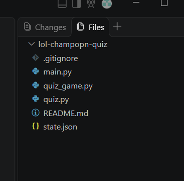

### 2. Git 및 GitHub


### 3. 퀴즈 기능 구현

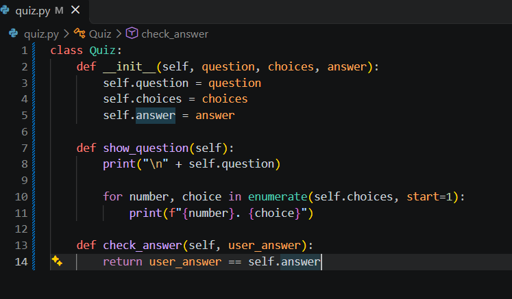


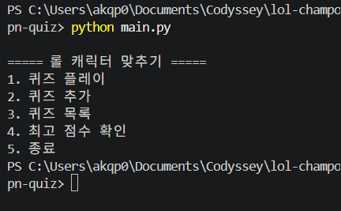


### 4. JSON 데이터 저장

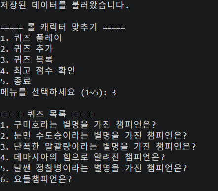

### 5. 예외 처리 및 오류 복구

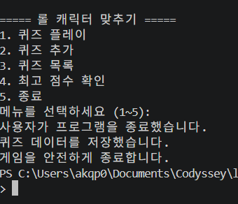


### 6. 브랜치 생성 및 병합

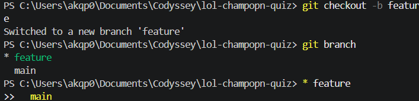


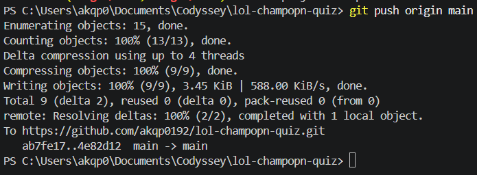

### 7. Clone 및 Pull

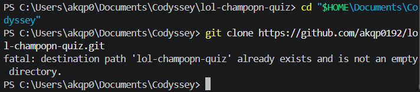

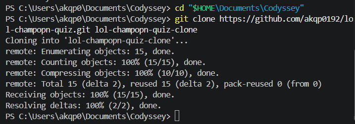

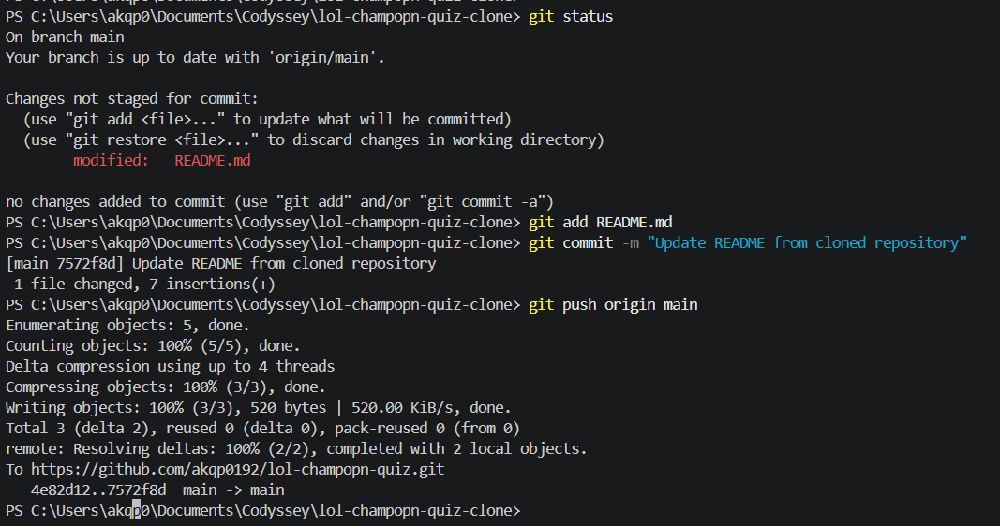

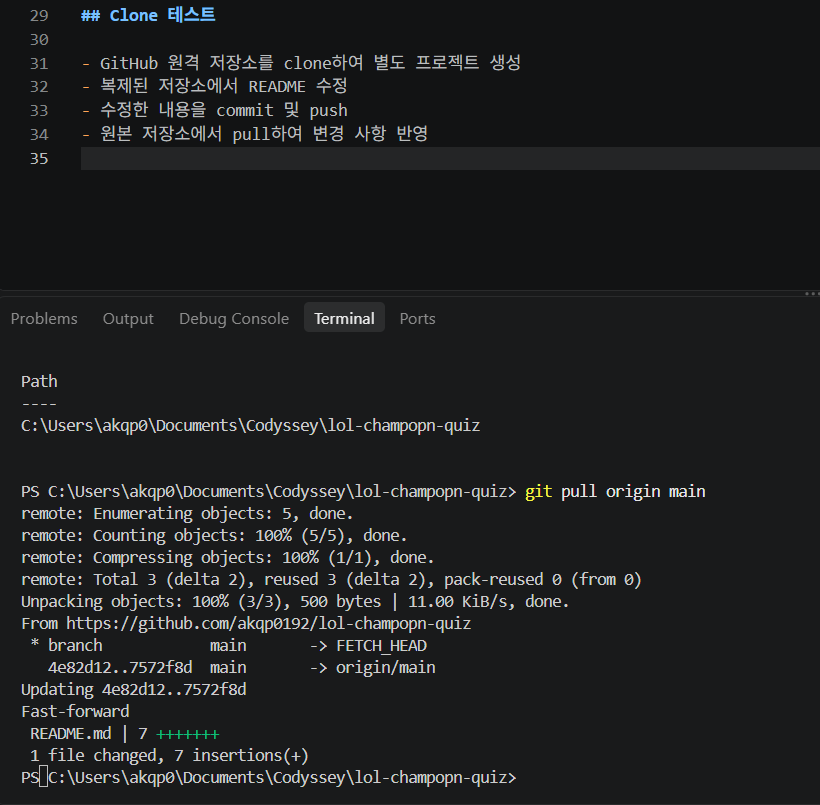

### 8. 최종 실행 결과


## 저장소

https://github.com/akqp0192/lol-champopn-quiz
